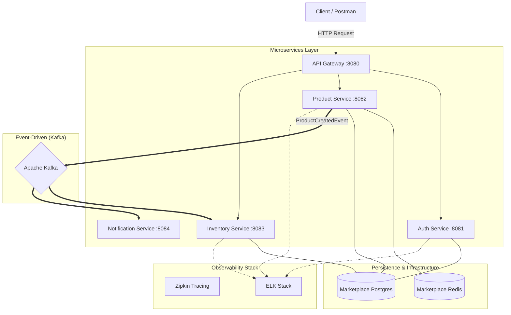

# Distributed Marketplace (Backend)

This is a microservices-based project built with **Java 17** and **Spring Boot 3.3.1**. I started this project as a monolith and gradually refactored it into a distributed architecture to learn how to solve common challenges in modern software development, such as service communication, data consistency, and cloud-native deployment.

## System Architecture



*Ports shown are the host ports from `docker-compose.yml`. The Notification Service is not exposed through the gateway; it only consumes Kafka events.*

The project is structured using **Maven Multi-Module** (9 modules: 5 services and 4 shared modules):

*   **Gateway Service:** The entry point for HTTP requests. Routes `/api/v1/auth`, `/api/v1/products`, `/api/v1/categories` and `/api/v1/inventory` to the matching services and applies a **Resilience4j** circuit breaker for fault tolerance.
*   **Auth Service:** Manages user authentication and authorization using **JWT** and **Spring Security 6**.
*   **Product Service:** Handles product listings, uses **Redis** to cache categories, and publishes a `ProductCreatedEvent` to Kafka when a product is saved.
*   **Inventory Service:** Manages stock levels, creates the stock record when a product-created event arrives, and uses pessimistic locking when stock is deducted.
*   **Notification Service:** Consumes the same product-created events from **Kafka**. At the moment it only logs them; real notification delivery (email, SMS) is a planned next step.
*   **Marketplace Common (core, web, persistence):** Shared modules for common DTOs, events and utilities.
*   **Marketplace Common Test:** A shared test kit that provides the infrastructure for integration tests (Testcontainers).

## Key Features & Learning Points

### 1. Handling Concurrency
In the **Inventory Service**, I implemented **Pessimistic Locking** (a database row lock inside a transaction) to prevent overselling when multiple orders try to deduct the same stock item at the same time. The second request waits until the first transaction finishes, then reads the updated stock and is rejected if there is not enough left.

### 2. Message-Driven Communication
I integrated **Apache Kafka** to let services communicate asynchronously:
*   The Product Service publishes a `ProductCreatedEvent` to the `product-created-topic` topic after a product is saved.
*   The Inventory Service and the Notification Service each consume the topic with their own consumer group (`inventory-group`, `notification-group`), so both receive every event.

### 3. Monitoring & Observability
To gain visibility into the distributed system, I integrated:
*   **Zipkin:** To trace request flows between services.
*   **ELK Stack:** Collecting and centralizing logs for easier debugging and monitoring.

## Infrastructure & DevOps

*   **Docker & Compose:** Used to manage the development environment with 13 containers (5 services, PostgreSQL, Redis, Kafka, Zookeeper, Zipkin, Elasticsearch, Logstash and Kibana).
*   **Kubernetes & Helm:** A **Helm Chart** and Kubernetes manifests are included for deploying the stack to a local Kubernetes cluster. The chart reads passwords and secrets from Kubernetes Secrets.
*   **CI/CD:** A **GitHub Actions** pipeline builds the services and pushes the Docker images to Docker Hub.

## Technical Challenges Solved

*   **Dependency Management:** Structuring the project into 9 modules while keeping a clean dependency graph without circular references.
*   **Environment Configuration:** Moving sensitive data (like passwords and secrets) out of the code and into **Kubernetes Secrets** and **environment variables**.
*   **Service Routing:** Configuring the API Gateway to route traffic by service name (URLs are set through environment variables), both in Docker Compose and in Kubernetes.

## Known Limitations & Next Steps

*   The Notification Service only logs events; sending real notifications is not implemented yet.
*   The Kafka event is published right after the product is saved, without a transactional outbox. If publishing fails, the error is logged and the event is not retried.
*   Stock deductions do not publish an event to Kafka yet.
*   The CI pipeline builds with tests skipped; running the tests in CI is a planned improvement.

### Note for Apple Silicon (M1/M2/M3) Users
This project is optimized for ARM64 architecture and Docker Desktop v29+.
To ensure a seamless development experience:
- Enable **"Allow the default Docker socket to be used"** in Docker Desktop Advanced Settings.
- The project is pre-configured to force **Docker API v1.44** via centralized Maven settings to resolve compatibility issues between modern Docker engines and Testcontainers.

## How to Run

### Prerequisites
*   Java 17 & Maven
*   Docker Desktop
*   Optional, for the Kubernetes deployment: Kubernetes enabled in Docker Desktop and Helm

### Steps
1. **Clone the repository:**
   ```bash
   git clone https://github.com/esrakonya/distributed-marketplace.git
   cd distributed-marketplace
   ```
2. **Build and test the project:**
   ```bash
   mvn clean install
   ```
3. **Run the full stack via Docker Compose:**
   ```bash
   docker compose up -d
   ```
4. **Use the system:** Send requests to the gateway at `http://localhost:8080`. Zipkin is available at `http://localhost:9411` and Kibana at `http://localhost:5601`.
